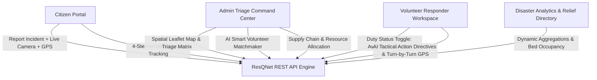

# 🚨 ResQNet — AI-Assisted Disaster Management & Emergency Response Coordination Platform

[](https://opensource.org/licenses/ISC)
[](https://react.dev/)
[](https://www.typescriptlang.org/)
[](https://nodejs.org/)
[](https://tailwindcss.com/)
[](https://leafletjs.com/)

ResQNet is an enterprise-grade, real-time emergency disaster coordination and decision-support platform designed to bridge the communication gap between **Citizens in distress**, **Certified Volunteer Responders**, and **Emergency Command Dispatchers** during natural disasters and catastrophic events (floods, fires, earthquakes, cyclones, and landslides).

---

## 🧭 Architecture Overview



---

## ✨ Key Features & Capabilities

### 1. 🚨 Citizen Emergency Reporting & Evidence Capture
- **One-Click GPS Pinpoint**: Browser Geolocation API coordinates auto-fill address and spatial pins.
- **In-Browser Live Camera Viewfinder**: Snap disaster photo evidence directly from smartphone or webcam with dual-lens (front/back) switching and instant frame compression.
- **Real-Time Duplicate Incident Warning**: Geospatial proximity engine checks within a 1.2 km radius and 24-hour window, alerting the citizen if a report was already logged to eliminate redundant dispatches.

### 2. 🤖 AI-Assisted Disaster Intelligence
- **Natural Language Emergency Classifier**: Heuristic NLP engine analyzes typed text descriptions, automatically classifying disaster type (`Flood`, `Fire`, `Earthquake`, `Cyclone`, `Landslide`) and severity level (`Critical`, `High`, `Medium`, `Low`).
- **Hazard Tag Extraction**: Automatically extracts situational risks (*⚡ High Voltage / Electrical Hazard*, *🚪 Trapped Individuals*, *🌊 Rapid Currents*, *☣️ Toxic Smoke Threat*).
- **Tactical Executive Summaries**: Generates concise single-sentence intelligence briefings for coordinators.
- **Multi-Factor Dispatch Matchmaker**: Scores volunteers (0–100%) by aligning disaster requirements against certifications (40%), proximity & transit ETA (40%), and duty availability (20%).

### 3. 📍 Spatial Map & Real-Time Proximity Routing
- **Interactive Leaflet Emergency Map**: Live pins with dynamic severity color codes, casualty counts, and details modals.
- **Haversine Distance & Transit ETA Engine**: Computes transit ETA in minutes based on calibrated urban disaster response speeds.

### 4. 🧑‍🚒 Certified Responder Operations
- **Duty Availability Switcher**: Volunteers toggle status between `Available`, `On Duty`, and `Offline`.
- **AI Tactical Responder Action Directives**: Step-by-step equipment checklists (*SCBA Oxygen Tanks, Flotation Vests, Thermal Imagers*).
- **Turn-by-Turn GPS Routing**: 1-click launch into Google Maps navigation directly to the incident coordinates.

### 5. 📦 Supply Chain Logistics & Shelter Directory
- **Relief Inventory Management**: Track field trauma kits, rescue boats, potable water, ration packs, ambulances, and family tents.
- **Atomic 1-Click Supply Allocation**: Dispatchers allocate relief resources to active incidents with automated stock level deduction (`In Stock`, `Low Stock`, `Depleted`).
- **Emergency Facilities Directory**: Spatial map tracking hospitals, relief camps, and emergency shelters with real-time bed capacity and hotline dialers.

---

## 👥 Demo Accounts & Pre-Seeded Profiles

| Role | Email | Password | Scope & Responsibilities |
|---|---|---|---|
| **Admin Coordinator** | `admin@resqnet.org` | `admin123` | Full Dispatch Command Center, AI Triage, Resource Allocation |
| **Volunteer (Marine & Water)** | `volunteer@resqnet.org` | `volunteer123` | Certified in Water Rescue, First Aid & CPR, Search & Rescue |
| **Volunteer (Medical & Fire)** | `volunteer2@resqnet.org` | `volunteer123` | Certified in Medical Paramedic, Disaster Logistics, Fire Response |
| **Volunteer (Heavy Machinery)** | `volunteer3@resqnet.org` | `volunteer123` | Certified in Heavy Machinery, Radio Communications |
| **Citizen Reporter** | `citizen@resqnet.org` | `citizen123` | Report emergencies, upload camera evidence, track live progress |

---

## 🚀 Quickstart & Local Installation

### Prerequisites
- [Node.js](https://nodejs.org/) (v18.0.0 or higher recommended)
- [npm](https://www.npmjs.com/) (v9.0.0 or higher)
- [Git](https://git-scm.com/)

### 1. Clone the Repository
```bash
git clone https://github.com/rikeshvijay948/ResQnet.git
cd ResQnet
```

### 2. Configure Environment Variables
Copy the sample environment files:
```bash
# Backend
cp backend/.env.example backend/.env

# Frontend
cp frontend/.env.example frontend/.env
```

### 3. Start the Backend API Server
```bash
cd backend
npm install
npm run dev
```
The backend will launch at `http://localhost:5000`.
*(Note: If MongoDB Atlas is offline or unconfigured, ResQNet automatically initializes an in-memory resilient data store so all APIs remain fully functional.)*

### 4. Start the Frontend Client
In a separate terminal window:
```bash
cd frontend
npm install
npm run dev
```
Open your browser at `http://localhost:5173`.

---

## 📡 REST API Reference

| Method | Endpoint | Description | Auth Required |
|---|---|---|:---:|
| `POST` | `/api/auth/register` | Register new user account | No |
| `POST` | `/api/auth/login` | Authenticate user and receive JWT | No |
| `GET` | `/api/auth/me` | Fetch authenticated profile details | Yes |
| `POST` | `/report` | Submit an emergency crisis report | Optional |
| `GET` | `/reports` | List all logged emergency incidents | No |
| `GET` | `/reports/:id` | Fetch specific emergency details | No |
| `PUT` | `/reports/:id/assign` | Dispatch responder or team to incident | Optional |
| `PUT` | `/reports/:id/status` | Update incident lifecycle status | Optional |
| `GET` | `/reports/:id/nearby-responders` | Compute nearby responder distances & ETAs | No |
| `POST` | `/api/upload` | Multipart photo evidence upload | Optional |
| `POST` | `/api/ai/classify` | AI NLP disaster classification & hazard extraction | No |
| `GET` | `/reports/:id/ai-intelligence` | Tactical briefing dossier & AI matchmaking | Yes |
| `GET` | `/api/analytics` | High-level crisis statistics & sector breakdown | No |
| `GET` | `/api/resources` | List relief inventory supplies | No |
| `PUT` | `/api/resources/:id/allocate` | Allocate relief supplies to an incident | Optional |
| `GET` | `/api/facilities` | List shelters, hospitals, and relief camps | No |
| `GET` | `/api/health` | Service uptime and storage diagnostics | No |

---

## 📄 License & Attribution

This project is licensed under the **ISC License**. Built with ❤️ for resilient disaster management.